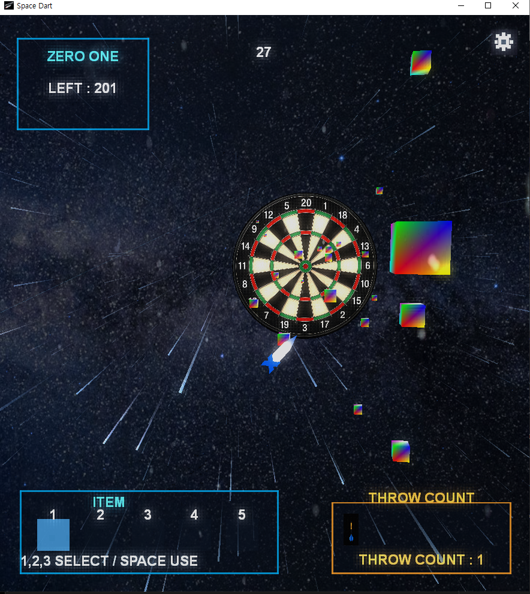
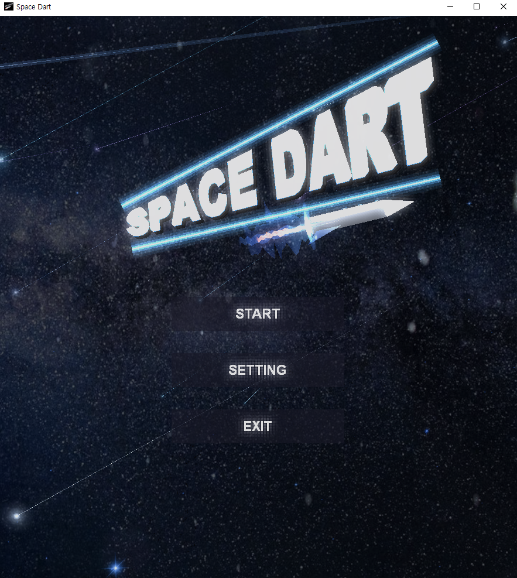
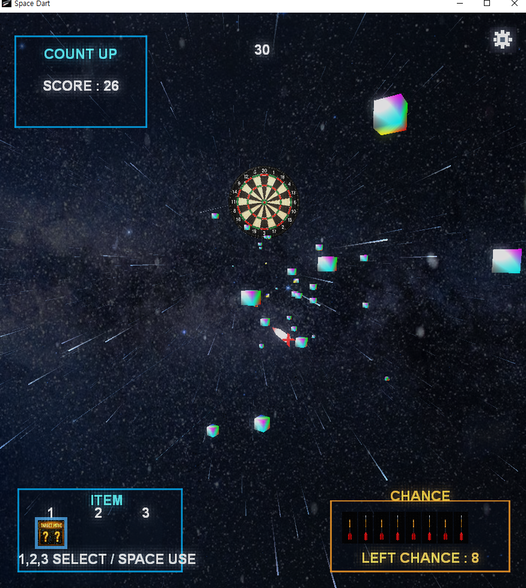
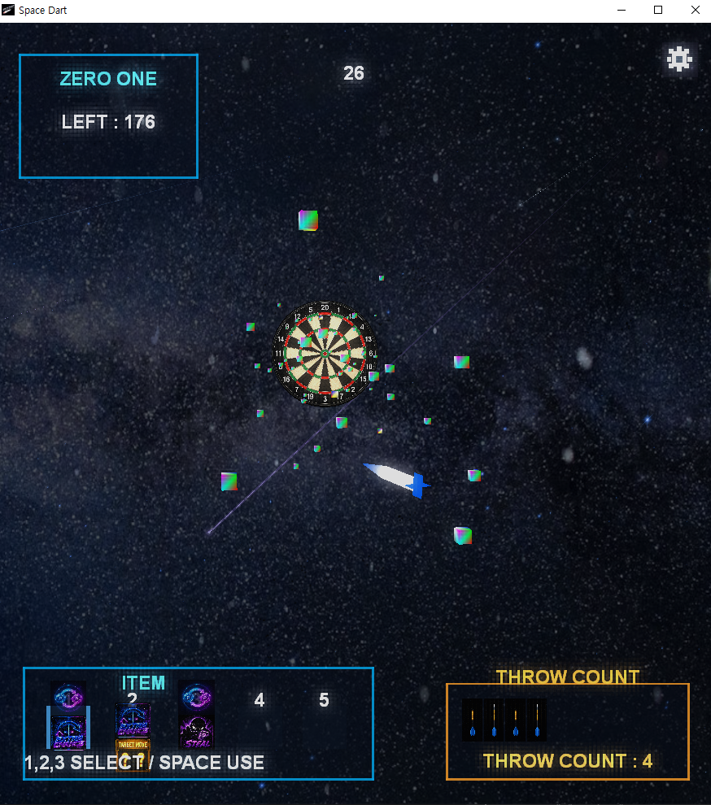
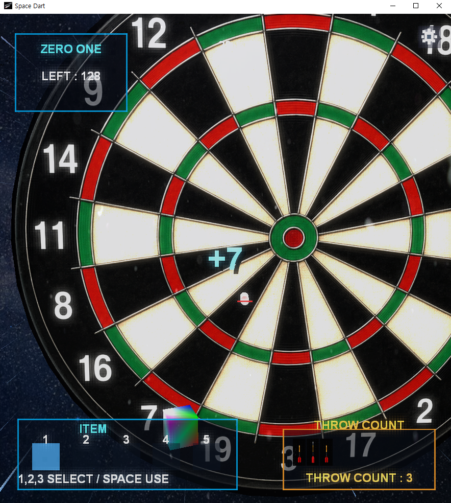
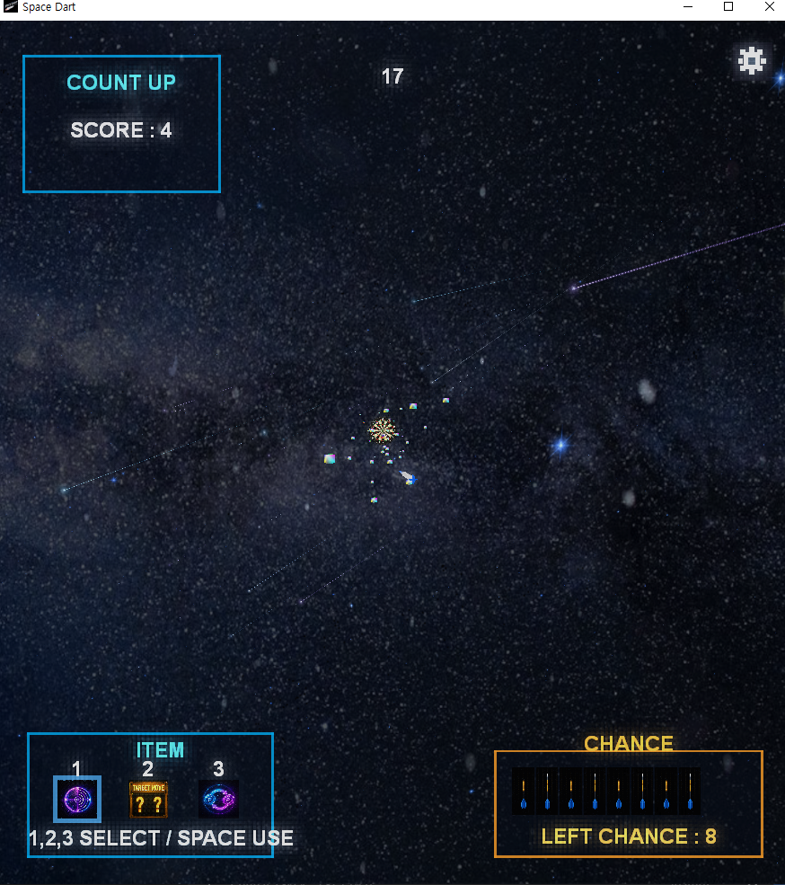

# Space Dart

**C++과 DirectX 9으로 제작한 1인 개발 3D 다트 아케이드 게임**입니다.

기본적인 다트 규칙에 직접 조작하는 비행 경험과 아이템을 결합했습니다. 렌더링, 입력, Scene 전환, 충돌·점수 판정, 규칙 기반 컴퓨터 플레이어, 우주 배경 연출을 구현하며 **기능이 실제 플레이로 연결되는 과정**을 경험했습니다.

## 프로젝트 정보

| 항목 | 내용 |
| --- | --- |
| 개발 기간 | **2026.05 ~ 2026.08** |
| 출시일 | **2026.09.08** |
| 현재 상태 | **출시 완료** |
| 개발 인원 | 1인 |
| 언어 | C++ |
| 그래픽 API | DirectX 9 |
| 플랫폼 / 개발 환경 | Windows / Visual Studio |

## 1. 시작과 개발 방향의 변화

DirectX 9을 공부하며 간단한 도형을 렌더링하고 움직여보는 과정에서 다트 게임을 구상했습니다. 처음에는 다트를 목표에 던지는 방식으로 접근했지만, **다트를 직접 조종한다면 어떨까?**라는 생각에서 방향을 바꿨습니다. 이후 우주 공간을 이동하는 다트라는 설정과 게임 규칙을 결합했습니다.

처음부터 모든 화면과 시스템을 설계한 것은 아닙니다. 플레이 화면에 필요한 기능을 추가하다가 Title, Play, Setting 등의 역할을 구분해야 할 필요성을 느꼈고, 점차 코드를 구조화했습니다.

## 2. 핵심 구현

### Scene 관리 — 화면별 책임 분리

Title, Play, Setting 등 화면을 Scene 단위로 구분하고 `CGameManager`에서 생성과 전환을 관리했습니다. 플레이 도중 설정 화면에 진입할 때는 기존 Play Scene을 보관하고, 돌아올 때 복원하여 점수·턴·아이템 상태가 유지되도록 처리했습니다.

- 관련 코드: [CGameManager.cpp](Space%20Dart/CGameManager.cpp) · [CScene.h](Space%20Dart/CScene.h)

### 입력과 UI — 한 번의 입력을 한 번의 행동으로

WinAPI 입력 상태를 프레임별로 비교해 키·마우스 입력을 처리했습니다. 현재 프레임과 이전 프레임을 구분하여 버튼을 누르고 있는 상태와 **새로 눌린 순간**을 구분하도록 했습니다. UI 버튼은 `CButton`으로 별도 관리했습니다.

- 관련 코드: [KeyProc.cpp](Space%20Dart/KeyProc.cpp) · [CButton.cpp](Space%20Dart/CButton.cpp)

### 컴퓨터 플레이어 — 상황에 따라 목표를 선택하는 규칙 기반 AI

무작위로 다트를 던지는 대신, 현재 점수와 게임 상황을 바탕으로 **후보 생성 → 가치 평가 → 목표 선택 → 조준**의 흐름으로 판단하도록 구현했습니다.

- **목표 후보:** 득점, 마무리, 다음 턴 준비, 안전한 선택 등을 생성합니다.
- **평가 기준:** 예상 점수, 마무리 가능성, 안정성, 버스트 위험을 반영합니다.
- **난이도 차이:** 판단 점수와 조준에 오차를 적용해 난이도별 차이를 만듭니다.
- **상황 대응:** 아이템·획득 가능한 큐브를 고려하고, 움직이는 과녁의 위치를 예측해 조준을 보정합니다.

이는 머신러닝 모델이 아닌 **직접 작성한 규칙과 평가식 기반의 게임 AI**입니다.

- 관련 코드: [CThink.cpp](Space%20Dart/CThink.cpp) · [CThink_Target.cpp](Space%20Dart/CThink_Target.cpp) · [CThink_Risk.cpp](Space%20Dart/CThink_Risk.cpp) · [CThink_Item.cpp](Space%20Dart/CThink_Item.cpp) · [CThink_Difficulty.cpp](Space%20Dart/CThink_Difficulty.cpp)

### 아이템과 게임 규칙 — 같은 조작에 다른 판단을 더하기

기본 다트 규칙 외에도 아이템 획득·사용과 효과 적용을 구현했습니다. 아이템은 점수나 과녁 상태, 투척 조건 등에 영향을 주고, 컴퓨터 플레이어 역시 상황에 따라 아이템 사용을 판단합니다. **조준과 점수 계산만 반복하는 흐름에 선택 요소를 추가**하려는 목적이었습니다.

- 관련 코드: [CItem.cpp](Space%20Dart/CItem.cpp) · [CItemEffectManager.cpp](Space%20Dart/CItemEffectManager.cpp) · [CPlayScene.cpp](Space%20Dart/CPlayScene.cpp)

## 3. 문제 해결과 개선 과정

### 충돌 판정 — 보이는 명중 위치와 실제 점수가 달랐던 문제

**문제**  
다트가 과녁에 맞았는데도 화면에서 보이는 명중 위치와 계산된 점수가 일치하지 않았습니다. 처음에는 점수 계산식을 의심했지만, 실제 원인은 판정에 사용하는 **위치 기준**에 있었습니다.

**원인과 수정**  
다트 오브젝트의 위치와 실제 핀 끝 위치는 다릅니다. 또한 한 프레임에 다트가 과녁 평면을 지나갈 수 있으므로, 현재 위치를 그대로 점수 계산에 사용하면 오차가 생깁니다. 따라서 **다트 끝 위치를 기준으로 과녁 평면과 만나는 지점을 보정**한 뒤, 해당 좌표로 점수 영역을 계산하도록 변경했습니다.

**검증**  
과녁의 여러 영역을 겨냥해 화면상의 명중 위치와 점수 결과를 비교했습니다. 이 경험으로 수식만 확인하는 것보다 **어떤 좌표를 기준으로 계산하는지 추적하는 과정**이 중요하다는 점을 배웠습니다.

- 관련 코드: [CPlayScene.cpp](Space%20Dart/CPlayScene.cpp) · [CCollision.cpp](Space%20Dart/CCollision.cpp) · [CDart.cpp](Space%20Dart/CDart.cpp)

### 우주 배경 — 이미지를 배치하는 것에서 공간감을 표현하는 것으로

**문제**  
초기에는 별 이미지를 여러 위치에 배치했지만, 화면에 붙은 이미지처럼 보여 거리감이 부족했습니다.

**개선**  
별의 거리와 역할에 따라 크기·밝기·반짝임을 다르게 표현하고, 카메라 이동에 따른 움직임을 적용했습니다. 유성은 진행 방향과 거리를 고려해 머리·꼬리·잔상을 구성했으며, 반투명 폴리곤을 겹쳐 빛이 번지는 형태를 표현했습니다.

**배운 점**  
같은 이미지를 많이 배치하는 것보다 **거리, 움직임, 밝기의 관계를 일관되게 설정하는 것**이 공간감을 전달하는 데 중요했습니다.

> 우주 배경 작업 기간은 약 **한 달 반**이며, 위에 기재한 전체 프로젝트 개발 기간과는 구분됩니다.

- 관련 코드: [CSpaceBackground.cpp](Space%20Dart/CSpaceBackground.cpp) · [CSpaceRenderer.cpp](Space%20Dart/CSpaceRenderer.cpp) · [CPostProcess.cpp](Space%20Dart/CPostProcess.cpp)

## 4. 프로젝트를 통해 배운 점

처음에는 화면에 필요한 기능을 하나씩 붙이는 방식으로 개발했습니다. 기능이 늘어나자 **역할을 나누고 실행 흐름을 관리하는 구조**의 필요성을 느꼈습니다.

특히 충돌 판정과 렌더링 문제를 겪으면서, 겉으로 보이는 결과만 수정하기보다 **문제의 발생 조건과 데이터 흐름을 추적하고, 수정 후 실제 플레이에서 확인하는 과정**을 중요하게 생각하게 됐습니다.

이 프로젝트는 완벽한 설계에서 출발한 결과물이 아니라, 직접 만들고 실패를 확인하며 개선한 첫 개인 게임 개발 경험입니다.

## 주요 소스 코드 안내

| 영역 | 소스 코드 |
| --- | --- |
| Scene 전환·관리 | [CGameManager.cpp](Space%20Dart/CGameManager.cpp) |
| 입력·UI | [KeyProc.cpp](Space%20Dart/KeyProc.cpp), [CButton.cpp](Space%20Dart/CButton.cpp) |
| 컴퓨터 플레이어 | [CThink.cpp](Space%20Dart/CThink.cpp), [CThink_Target.cpp](Space%20Dart/CThink_Target.cpp) |
| 충돌·점수 계산 | [CPlayScene.cpp](Space%20Dart/CPlayScene.cpp), [CCollision.cpp](Space%20Dart/CCollision.cpp) |
| 우주 배경·후처리 | [CSpaceBackground.cpp](Space%20Dart/CSpaceBackground.cpp), [CSpaceRenderer.cpp](Space%20Dart/CSpaceRenderer.cpp), [CPostProcess.cpp](Space%20Dart/CPostProcess.cpp) |
| 아이템 | [CItem.cpp](Space%20Dart/CItem.cpp), [CItemEffectManager.cpp](Space%20Dart/CItemEffectManager.cpp) |
